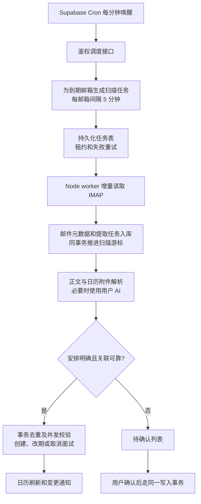

# 邮箱面试安排自动同步设计

日期：2026-10-14。代码基线：`origin/main`，`9b0645d`。设计分支：`codex/mail-interview-auto-sync-design`。

交付状态：功能与交互设计，附离线可点击预览。尚未接入真实邮箱、调用用户 AI、执行数据库迁移或部署。源代码检查证明的是当前主分支实现；线上数据库结构、扩展、凭据可用性与项目套餐须在开发阶段核实。

## 1. 用户得到的行为

用户已设置可用的 AI API、连接邮箱后，系统自动检查新邮件，将已经确定的面试写入现有面试日历。网页关闭、设备离线时，服务器继续运行。默认每个邮箱每 5 分钟检查一次；正常负载下目标是新邮件收到后 5–8 分钟完成处理，此数字是待实测的目标，不是即时推送承诺。

- 自动同步默认开启，用户可按邮箱暂停、恢复；无需逐封确认明确的新面试。
- 只自动录入有证据的安排。时间不明确、关联不唯一或与手动修改冲突时，进入待确认。
- 重复通知不重复创建；明确改期更新原安排；明确取消保留历史并从有效安排中移出。
- 每条记录都能查看来源邮件、识别依据和变更历史。
- 保留现有邮件列表 + 邮件详情结构、全局导航、日历同一时段多卡片、点击详情、拖动改期和手机布局。

## 2. 已确认的现有实现与接入点

| 已检查的代码 | 当前行为 | 设计所需改动 |
| --- | --- | --- |
| `src/pages/Mailbox.tsx` | 手动 POST 拉取最近 40 封；前端传邮箱和授权码；“已处理”存在 localStorage | 账号 ID 鉴权拉取；增加同步状态；服务端持久化识别结果 |
| `api/mailbox-fetch.ts` | Node TLS IMAP；列表最多 50 封；详情 BODY.PEEK；未提供 UIDVALIDITY、完整正文和邮件线程头 | 抽离共享 IMAP 客户端；新增增量扫描、消息标识和完整 MIME 解析 |
| `src/components/MailInterviewDraft.tsx` | 正则预填，用户确认后创建；按旧邮件来源计算稳定 ID | 保留手动入口；与自动流程共享来源关联和去重事务 |
| `src/lib/mailInterview.ts` | 来源标记、日期正则和邮件 ID | 保留旧标记兼容；新流程显式保存来源，时间解析带时区 |
| `src/contexts/ApiKeysContext.tsx` | `user_api_keys` 保存 Key；当前 provider 在浏览器 localStorage | 将同步选用的 provider 保存到服务器；已有 Key 无需再次输入 |
| `api/ai-credentials-save.ts`、`api/_lib/crypto.ts` | 已有服务端 AES-GCM 加密凭据能力，使用 `AI_CREDENTIAL_MASTER_KEY` | 复用加密工具和凭据，不重复创建另一套密钥入口 |
| `api/_lib/ai-providers.ts`、`src/lib/providers.ts` | 服务端列表与页面列表有差异：服务端缺 Claude、豆包，且部分默认 model 不同 | 统一注册表及调用适配器，支持页面既有 8 家服务商；沿用所选模型 |
| `src/pages/Interviews.tsx` | `useCollection('interviews')` 读写；拖动保留分钟并支持撤销 | 增加来源与取消状态；保护人工修改；后台变更刷新视图 |
| `src/hooks/useCollection.ts` | 挂载读取和本地 CRUD；没有后台变更订阅 | 日历专用刷新 hook，避免全站无差别轮询 |
| `supabase/schema.sql` | `interviews` 已有 `application_id`、用户归属；缺取消状态与来源字段 | 增量加列与关联表，保留已有 ID、业务数据和用户归属约束 |
| `vercel.json` | 已有 Node API 和每日校招 Cron，邮箱函数时限 30 秒 | 新任务独立时限和调度；保留原校招任务 |

邮箱当前授权码受 RLS 隔离，但仍能在本人前端读到。自动任务改为后端读取加密凭据，并将邮箱浏览器请求改为账号 ID；这是持续后台读取所需的凭据接入改动。

## 3. 后台结构

采用 **Supabase Cron + 持久化任务表 + Vercel Node worker**。IMAP 沿用 Node 运行环境，短连接每次检查，不在请求结束后保持连接。



Supabase Cron 支持定时 HTTP 请求，可通过 `pg_net` 唤醒外部 API。调度密钥保存在 Vault，Vercel 环境保存对应校验值。使用该结构是结合现有 Node IMAP 的设计选择。[Cron 文档](https://supabase.com/docs/guides/cron)、[HTTP 调度示例](https://supabase.com/docs/guides/cron/quickstart)、[pg_net](https://supabase.com/docs/guides/database/extensions/pg_net)、[Vault](https://supabase.com/docs/guides/database/vault)。

Vercel Hobby 当前的内置 Cron 最小间隔为一天，因此设计不把“每 5 分钟”建立在尚未核实的 Vercel 套餐上。若开发时确认 Pro 且决定使用内置 Cron，可复用相同调度接口，无需改识别规则。[Vercel Cron 限制](https://vercel.com/docs/cron-jobs/usage-and-pricing)。

执行边界：

- 调度每分钟运行；持久化下一次扫描时间。空邮箱只读元数据，不调用 AI。
- worker 时限拟为 120 秒，内部硬截止 90 秒；初始最多 4 个 worker 并发，单邮箱扫描互斥。实际平台时限在部署前核实。
- dispatcher 等待它发起的 worker 请求；Cron HTTP 返回状态与任务完成状态分别记录。禁止把 HTTP 请求成功等同于面试已入库。
- 任务由数据库原子领取并取得租约与递增 fencing token；过期租约可重领，旧 token 无权写入。提取任务和扫描任务分开，不让 AI 超时阻止继续发现新邮件。
- 邮件元数据、提取任务、扫描游标必须同事务提交。AI 失败可重试已入队邮件，不能因游标已推进而丢失。
- 短暂失败按 1、5、15、60 分钟退避，最多 5 次后进入可重试失败列表；授权无效暂停该账号，AI 额度不足暂停提取并保留积压。
- 暂停在任务领取和最终写入前都检查。正在提交的事务以配置版本作为条件，暂停生效后不再写入新安排。恢复后从旧游标补扫暂停期间新邮件。
- 服务恢复优先处理积压，按账号公平调度；队列等待时间超标显示“检查延迟”，不宣称运行正常。

## 4. 新邮件与第一次启用

持久化 `(mailbox_account_id, folder, uidvalidity, uid)` 作为物理邮件唯一键。解析 `Message-ID`、`In-Reply-To`、`References`，并保留内容哈希和服务器 INTERNALDATE；已读标志不参与增量检测。

IMAP UID 查询必须过滤 `uid > last_uid`，避免范围星号返回旧 UID；使用 UID，不使用会因删除邮件改变的消息序号。先枚举全部新增 UID，再分页处理，不能只抓最新 40/50 封而跳过积压。

- 首次启用：服务器记录 `enabled_at`，在建立高水位时将扫描窗口与该时间对齐。并发到达的邮件必须被下一批发现；初始化不能把启用后到达的邮件直接跳过。
- 默认处理启用后的邮件；另有“补充最近 7 天安排”，由用户主动发起。历史面试已过期则展示历史候选，不加入未来安排。
- 第一版自动范围为 INBOX，界面注明“检查收件箱”。用户邮箱规则把通知移到其他文件夹时，提供选择监控文件夹；每个文件夹独立游标，来源邮件与业务安排跨文件夹去重。
- UIDVALIDITY 变化：重建该文件夹游标，以启用时间和消息指纹复查，不复用旧 UID 对应的邮件。
- 最近新增超过单批容量：持久化分页任务继续扫描，目标延迟随积压显示；不丢弃超额邮件。
- 读取使用 PEEK，不改变邮件已读状态。正文过长、截断或只有截图/PDF 时进入待确认，不能依据不完整正文自动录入。第一版支持文本/HTML和单次 `.ics`；图片 OCR、PDF、多场重复日程另作扩展。

## 5. AI 与确定性校验

先解析 MIME，将正文最新回复与引用历史分离，保留原邮件证据。`.ics` 提取 UID、SEQUENCE、DTSTART、DTEND、TZID、ORGANIZER 等；日程结构字段确定后，仍需确认属于面试而非普通会议。重复日程、多事件复杂附件暂进入待确认。iCalendar 字段依据 [RFC 5545](https://www.rfc-editor.org/rfc/rfc5545)。

候选过滤同时检查主题、短正文和 `.ics`。仅含“Offer、笔试、测评”不等于面试；短正文不明确时继续做一次分类，不能仅凭主题没有“面试”就忽略正文中的通知。

AI 只返回结构化数据，不能直接读写日历或调用其他工具。邮件里的“忽略规则”等内容作为邮件文本处理。示意返回：

```json
{
  "action": "create",
  "certainty": "confirmed",
  "company_name": "星河科技",
  "position_name": "产品经理",
  "round": "一面",
  "local_start": "2026-10-16T09:34:00",
  "timezone": "Asia/Shanghai",
  "interview_type": "视频",
  "meeting_url": null,
  "location": null,
  "contact": null,
  "prior_start": null,
  "evidence": [{ "field": "local_start", "text": "面试时间：2026年10月16日09:34（北京时间）" }],
  "missing_fields": [],
  "ambiguities": []
}
```

`action` 限定 `create / reschedule / cancel / ignore / review`；写入对象、用户 ID 和目标面试 ID 必须由后端可信关联逻辑确定。AI 自报 confidence 只作诊断，不能单独放行。

| 规则 | 行为 |
| --- | --- |
| 新面试有明确公司、日期、开始时间，最新正文证据一致 | 自动新增；岗位、轮次、形式缺失可留空 |
| 日期有效且包含明确年份，或可无歧义解析相对日期 | 以固定 IANA 时区转 UTC 保存 |
| 国内邮件无时区 | 采用该用户已保存的默认时区 `Asia/Shanghai`，详情标注采用了默认时区 |
| “明天下午 3 点” | 以邮件发送日期解析，仅发送日期与 INTERNALDATE 一致可信时自动；不能以 worker 运行日解析 |
| 无年份涉及跨年、日期星期不一致、海外时区不明、夏令时重复/不存在的时间 | 待确认，保留原文 |
| “下周联系”“可选周三或周四”“时间另行通知”“有空吗” | 待确认；没有明确具体邀约的普通招呼可直接忽略 |
| 取消邮件缺新时间 | 原安排关联唯一且取消证据明确时可取消，无需新时间 |
| 改期没有新时间，或引用旧邮件中的时间 | 待确认，不把引用时间当作新安排 |
| 正文与 `.ics` 相互冲突，或正文不完整 | 待确认 |
| 没有结束时间 | 留空；不擅自补 30/60 分钟 |
| JSON 错误、字段过长、证据不匹配或模型失败 | 不写入；有限重试后可手动处理 |

同一封邮件包含多场独立面试时返回事件数组，每个事件独立校验；第一版若事件归属无法区分则整体待确认，不能默认只取第一场。

## 6. 去重、改期与人工操作

关联强度按顺序使用：用户范围内的 `.ics` 日程 UID + organizer、同线程头与现有来源、明确旧时间及公司/岗位/轮次。邮件线程和同公司都可能包含多轮，必须检查候选是否唯一；只靠公司相同不更新。

- 物理邮件唯一约束防同一 UID 多次处理；消息指纹防移动、转发和再次通知；业务指纹包含公司、岗位、轮次、开始时间，不能用“同一时段”去重。
- 业务指纹遇到疑似重复但无强关联时转待确认，不静默合并可能不同的面试。同一公司不同岗位/轮次/时间保留独立安排。
- 明确重复同一通知：标为重复并关联已存在面试；手动与自动并发使用同一事务和唯一来源键。
- 新安排与手动记录精确匹配但无法证明是同一场：待确认。关联投递沿用 `interviewApplicationMatch.ts`，公司+岗位唯一时关联，否则 `application_id=null`。
- 改期/取消前比较上次自动写入字段快照与当前值；用户改过任一将被覆盖的字段，生成待确认差异。备注不在自动覆盖范围，原手工备注始终保留。
- 写入时行锁和版本条件防检查后发生拖动；冲突返回待确认，不盲目重试覆盖。
- 乱序处理使用同日程 SEQUENCE 或可信邮件时间和先后关系；旧通知不覆盖新安排。无法判断先后转待确认。
- 用户删除面试时，在同事务为关联来源留 `suppressed/deleted_by_user` 标记，再删除原记录；源关联使用 ON DELETE SET NULL，不删除抑制记录。重试、补扫和重复通知不会重建。
- 用户“忽略此建议”仅抑制该建议；“不再自动同步此场面试”抑制该业务安排后续自动变更。新的独立轮次仍可正常识别。
- 取消采用 `status=cancelled`，保留 ID、来源和变更历史；日历、总览计数、最近面试和提醒统一排除已取消项，历史列表可查看。
- 撤销后台变更必须携带变更版本，只有当前仍为该变更结果时可恢复；否则提示已发生后续变化。

## 7. 数据结构草案

名称与字段在开发时生成迁移文件后落实；下面不是已经执行的 SQL。

| 表 | 核心字段与约束 | 可见性 |
| --- | --- | --- |
| `mailbox_accounts` | 保留账号 ID；增加 `secret_configured`、`credential_version`；邮箱授权码迁出前端可读列 | 用户只读自己的元数据，通过接口保存修改 |
| `mailbox_credentials` | `account_id`、`user_id`、`encrypted_secret`、加密版本；复合归属约束 | 后端专用，浏览器无表权限 |
| `mail_interview_sync_settings` | 每账号一条；`user_id`、`enabled`、`enabled_at`、`provider`、`model`、`timezone`、`interval_seconds=300`、`config_version`、`last_checked_at`、`last_success_at`、`error_code`、`consecutive_failures` | 本人读，鉴权接口写 |
| `mailbox_sync_cursors` | 每账号/文件夹一条；`uidvalidity`、`last_uid`、`next_scan_at`、租约、fencing token | 后端写；前端取汇总 |
| `mail_sync_jobs` | 扫描/提取/历史补扫；状态、唯一任务键、尝试次数、`next_attempt_at`、租约、fencing token | 后端专用 |
| `mail_sync_messages` | 物理唯一键；Message-ID/线程头、内容哈希、INTERNALDATE、原日期、主题、发件人、有限正文证据、识别状态 | 本人读必要字段，后端写 |
| `interview_mail_sources` | `(user_id, interview_id, message_id, event_key)`，自动字段快照、抑制原因、ICS版本 | 本人读，受控写；删除面试保留抑制信息 |
| `mail_interview_suggestions` | 原文证据、候选操作、原因码、建议值、目标版本、待确认/已接受/已忽略 | 本人读，通过版本校验接口确认 |
| `interview_change_log` | `user_id`、目标、来源、actor、before/after、version、时间、抑制/撤销 | 本人读，后端追加 |
| `interviews` | 增加 `status=scheduled`、`source=manual`、`version`、可选 `end_time`/`timezone`/`meeting_url`/`location`/`contact` | 保留现有用户归属和投递外键 |

所有关联同时验证 user_id；不能让 service_role 根据请求里的账号或面试 ID 直接操作。公开 schema 表启用 RLS；用户接口取身份自 JWT；后端专用表撤销 anon/authenticated 权限。新表 Data API 授权需与 RLS 分别核实。

默认保留识别结果与最小证据；非候选正文不持久化，候选完整正文只作短期处理缓存（7 天），变更证据保留到用户删除。原邮箱链接用账号/文件夹/UIDVALIDITY/UID重新读取；原邮件删除时显示“原邮件已不可读取”并展示已保留证据。

## 8. 凭据接续与兼容上线顺序

1. 增量加表/列，旧接口保持可用；前端“自动同步”先显示准备状态，不在迁移未完成时假显示已开启。
2. 为已有邮箱授权码与当前 AI Key建立加密后端副本；服务端解密校验和连接测试成功后记版本。全程不打印明文、不开新 API Key、不更换用户服务商。
3. `activeProvider` 在用户设置变化时持久化至同步配置；历史用户首次进入时接续浏览器选择。无法确定原选择时，在已有服务商中让用户选择一次，不要求再次填写 Key，也不擅自切换供应商。
4. 统一 8 家服务商注册表；复用已有 Claude 和 OpenAI-compatible 提取适配器；模型支持及配置开发时逐家验证。
5. 邮箱接口改为 JWT + account_id；元数据视图/接口不返回授权码，页面改为“已保存，可替换”。AI 旧功能短期保留 `user_api_keys` 兼容读取，自动 worker只读加密副本。
6. 解析旧 notes 来源标记并与当前用户的旧手动导入记录关联；无法可靠迁移的记录仅待确认，不重建/覆盖。旧 localStorage“已处理”只影响阅读整理，不视为日历已录入。
7. 启用调度与自动开关，设置生效起点。通过真实后台验收后清空迁移完成的旧邮箱明文列并撤销读权限；失败账号保留可用旧路径并显示迁移待处理。
8. 同步相关凭据替换/删除必须同时更新加密副本版本，取消旧任务；后台不能使用已经被用户删掉的旧 Key。不同浏览器修改 provider 不偷偷改变已有邮箱的选用值，页面明确显示当前服务商。

## 9. 接口契约草案

| 接口 | 认证 | 作用 |
| --- | --- | --- |
| `GET /api/mail-sync-status?accountId=...` | 用户 JWT + 账号归属 | 同步状态、最近成功时间、待确认数量、当前 AI；不返回凭据 |
| `POST /api/mail-sync-settings` | 用户 JWT | 按账号开启/暂停、选择已配置 AI、时区/文件夹；校验配置版本 |
| `POST /api/mail-sync-run` | 用户 JWT | 当前邮箱立即检查或补扫近 7 天；幂等键、60 秒节流；202 表示已安排任务 |
| `GET /api/mail-sync-suggestions` | 用户 JWT | 本人的待确认与证据 |
| `POST /api/mail-sync-suggestion-resolve` | 用户 JWT | 接受/修改/忽略；重新校验目标版本并事务写入 |
| `POST /api/mailbox-account-save` | 用户 JWT | 测试并加密保存邮箱凭据；返回元数据 |
| `POST /api/mailbox-account-delete` | 用户 JWT | 原子暂停、清理凭据与未完成任务；保留用户面试 |
| `POST /api/mailbox-fetch` | 用户 JWT | 改用 account_id + folder/uidvalidity/uid，后端加载凭据 |
| `POST /api/internal/mail-sync-dispatch` | 专用调度 secret | 生成到期扫描任务并调度 worker |
| `POST /api/internal/mail-sync-worker` | 专用内部 secret | 原子领取任务与有限处理；不能由浏览器指定任意用户身份 |

接口返回稳定原因码，如 `AI_NOT_CONFIGURED`、`AI_AUTH_INVALID`、`AI_QUOTA_EXCEEDED`、`MAIL_AUTH_INVALID`、`TIME_AMBIGUOUS`、`MANUAL_EDIT_CONFLICT`、`DUPLICATE`；页面展示中文处理方法。自定义 IMAP 主机验证公网解析、TLS 与允许端口，拒绝访问本地/内网地址及 DNS 重绑定；已配置服务商只用可信注册表 endpoint。

## 10. 页面交互设计

在现有邮箱账号卡下方加入一条紧凑同步状态行，不增加邮件分类侧栏。视觉沿用邮箱米白、细描边、暗色按钮，以及日历现有主题变量。预览只展示主内容区域，预览工具条不属于产品。

| 状态 | 显示文案 | 主操作 |
| --- | --- | --- |
| 正常 | 自动加入面试日历 · 已开启；使用当前 AI；每 5 分钟检查；最近成功时间 | 立即检查、暂停 |
| 待确认 | 有 N 封邮件需要确认；其余明确安排照常同步 | 查看待确认 |
| 检查中 | 正在检查新邮件 / 正在识别面试安排 | 禁用重复检查；保留暂停 |
| 用户暂停 | 自动同步已暂停；已录入安排保留 | 恢复 |
| 未设置 AI | 配置 AI 后自动识别面试安排 | 打开现有 AI 设置 |
| 未连接邮箱 | 连接邮箱后自动同步 | 打开现有绑定邮箱 |
| 授权/额度失败 | AI 不可用或邮箱连接失效，待处理邮件已保留 | 修复对应设置、重试 |
| 队列积压或后台异常 | 检查延迟；最近成功时间显示真实值 | 查看状态、立即重试 |

邮件详情：自动录入的邮件显示“已加入日历 / 已更新日历 / 已取消安排”，主按钮为“查看日历安排”。时间不明确时显示缺失字段，提供手动填写；冲突展示“当前手动时间 → 邮件建议时间”，提供“保留手动时间 / 采用邮件时间”。

日历详情：增加小型“来自邮箱”来源及最新变更时间，提供“查看来源邮件 / 查看变更记录”。取消项只在历史视图展示。自动来源样式不挤占时间卡片内容，同一小时每场仍分别可点。超出 08:00–20:00 的安排保存后在当天列表展示并给提示，不能保存成功却完全不可见。

前端更新：日历及邮箱状态可见时每 30 秒查询轻量变更版本，收到变化再刷新数据；标签页恢复可见时立即检查。使用保留当前 items 的静默刷新，避免编辑器卸载和拖动回滚；有未保存编辑时只更新背后数据，保存时执行版本冲突处理。Realtime可作为后续优化，第一版不以其部署配置为前提。后台自动通知汇总新增/改期/取消数量，未变化时不反复弹 Toast。

手机保留现有日历列表与邮件列表/详情切换，状态行折叠换行；待确认用全屏 sheet，不能产生整页横向溢出。交互支持键盘、明确 focus、屏幕阅读器状态与 reduced-motion。

同步开关旁说明：仅将候选面试邮件的必要内容发送给当前选用的 AI 服务商识别；普通邮件不送入提取流程。已配置多个 AI 时展示实际选用服务商，方便用户了解识别来源和 API 用量。

## 11. 开发与验收

依次实现凭据接续、持久化增量扫描、提取和事务规则、状态与待确认界面、调度及端到端验证。每阶段保留现有手动路径；回滚时关闭调度/同步开关，已经保存的面试与历史继续可读。

必须验证：

1. 关闭全部网页 → 测试邮箱收到明确通知 → 后台任务完成 → 重新登录日历 → 数据已保存且来源正确。仅 build、HTTP 200、网页打开时扫描都不算通过。
2. 重复执行、并发手动加入、重复通知、UIDVALIDITY 重置、邮件移动：同一场不重复；不同岗位/轮次、同一小时多场不误合并。
3. 明确改期分钟保留；乱序旧通知不覆盖新安排；取消后日历、统计和提醒一致，历史仍可追溯。
4. 手动拖动与自动改期并发：保留用户修改并产生待确认；用户删除、忽略后的重试和历史补扫不重建。
5. 相对日期、跨年、星期冲突、UTC/海外/DST、引用历史日期、正文截断、无开始时间、多事件邮件和 `.ics`冲突：符合规则且无猜测录入。
6. 超过 50 封新邮件、失败后恢复、worker租约过期、写入后应答丢失：任务重试不丢信、不重复，积压状态真实。
7. AI 额度/凭据失效和邮箱授权失效：暂停正确阶段；修复后继续旧队列；没有重复付费无限重试。
8. 用户 A 不能读取或修改 B 的账号、建议、来源或面试；浏览器响应/打包文件/日志不出现明文凭据，暂停/删 Key与并发写入正确互斥。
9. 已打开日历在下一次轻量检查后反映后台变化；未保存编辑、点击详情、拖动撤销、同小时多卡、手机布局不退化。
10. 使用现有已配置服务商逐家验证适配，不用合成 AI 返回结果冒充真实提取验收；数据库迁移、权限、实际调度和功能页面分别留证据。

开发前核实实际数据库扩展与 API 权限、Cron/Vault/pg_net 状态、Node运行时和函数时限、已有8家AI的当前配置。已阅读 Supabase 最新 changelog：新TLS策略和pgcrypto旧算法变更需在运行环境检查中覆盖；既有 Web Crypto AES-GCM方案不依赖旧PGP算法。[TLS变更](https://supabase.com/changelog/cbc-tls-ciphers-deprecated)、[Postgres变更](https://supabase.com/changelog/postgres-15-19-17-11-breaking-changes)。
